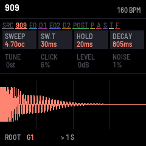

# GABBERKIX

GABBERKIX turns the M-VAVE FM-1 into a hardcore kick designer. A kick in three layers: a synthesized 909 through two
rounds of EQ and distortion for character, a punch for the attack and a sub for the low end, pressed into one kick by
groups driven hard into clippers. Throw random gabber kicks, shape every stage, keep sixteen presets, resample one
into a new kick, play it on every beat or pitched from the keys, and follow or send MIDI clock.

This is version {{VERSION}}. It works on both FM-1 flash chips. You install it at your own risk, and the installer can
put M-VAVE's own firmware back.

- [Try it in the browser](emu/). Play it right here, with sound. It runs the same code as the FM-1.
- [Install](install/) it from Chrome or Edge, with the FM-1 connected by USB.
- [Render your presets](render/) to WAV or AIFF files: one by one, or all sixteen in a ZIP.
- [Back up and restore](backup/) your presets.
- The [README](https://github.com/ejtb76/gabberkix#readme) explains the pages, the controls, the presets and MIDI.
- [Download {{PKG}}](firmware/{{PKG}}) to use the command-line installer: `python3 base/tools/fm1_install.py {{PKG}}`.
- The [source](https://github.com/ejtb76/gabberkix) is under GPL-3.0. It's built on fm1-base and felucca-bsp, which
  come from Felucca by Leo Kuroshita, Hügelton Instruments. Every sound is synthesized.

M-VAVE and FM-1 are trademarks of their owners. GABBERKIX is not affiliated with M-VAVE.
